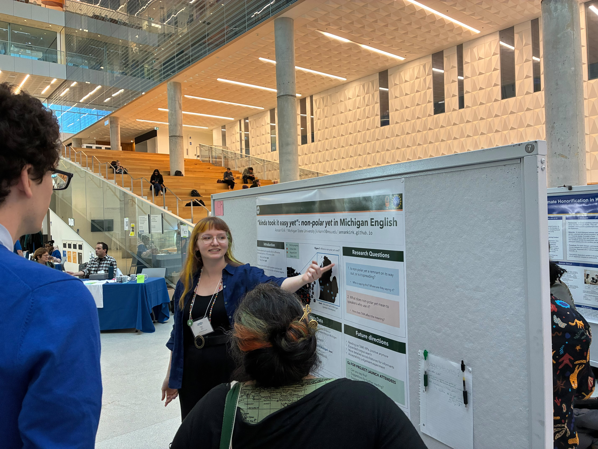

At NWAV 54 I presented a project launch poster titled __‘Kinda took it easy yet’: non-polar yet in Michigan English.__
[Download the poster](https://raw.githubusercontent.com/annankirk/annankirk.github.io/95f5f92e4a024cb54fe985e2f9f831c215bf9d49/assets/YET_NWAV54_V2.pdf) or read the [MSU Sociolab post](https://sociolab.msu.edu/2026/10/20/lab-members-presenting-at-nwav-54/).

The title, "kinda took it easy yet," comes from the [MI Diaries](https://mi-diaries.org/) corpus: "Finally Saturday afternoon, I'm like, okay, I feel, I feel like myself again, and **kinda took it easy yet** on Saturday. And then, um, today I feel normal" (MCD-00235; b1958; F).

What's interesting about this is that time adverb _yet_ is an NPI for most speakers, but the example above is **not** an environment that licenses NPIs. 

This is a work in progress! Please reach out to me at <kirkann1@msu.edu> if you're interested in hearing more or helping out.

